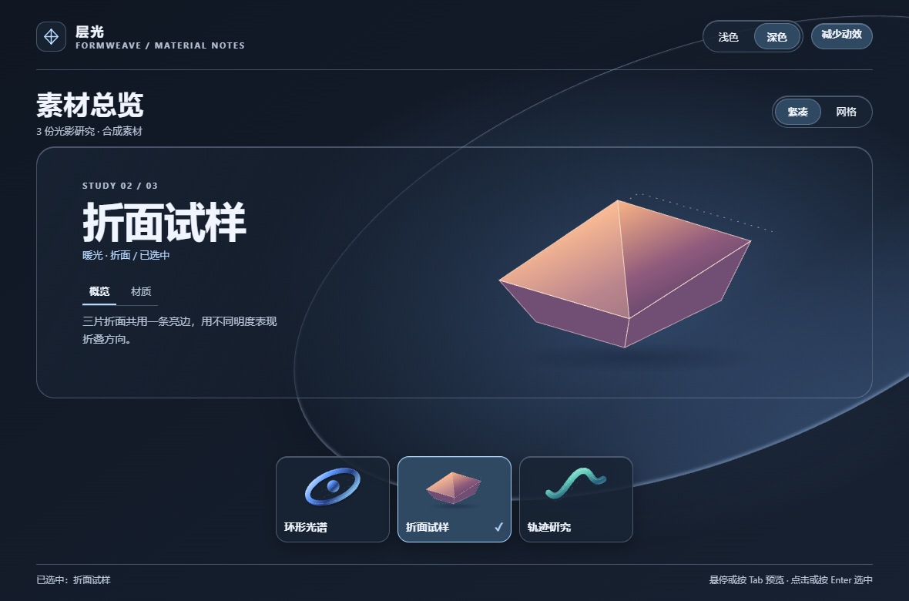
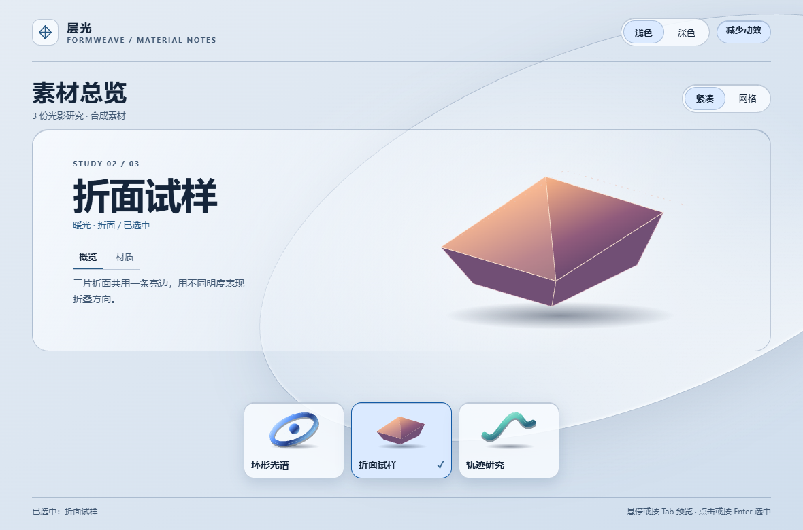
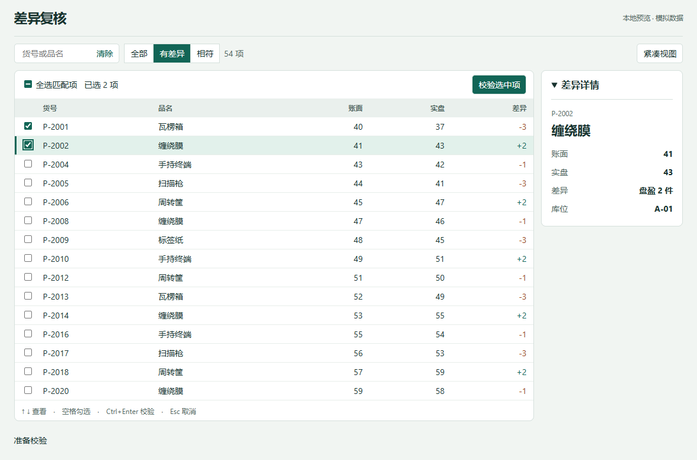
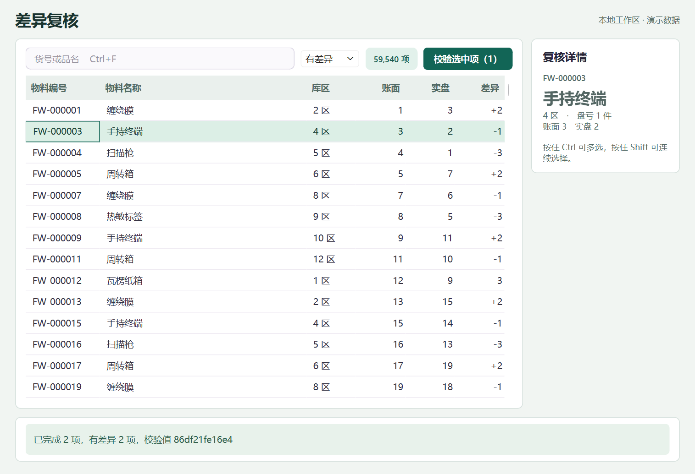
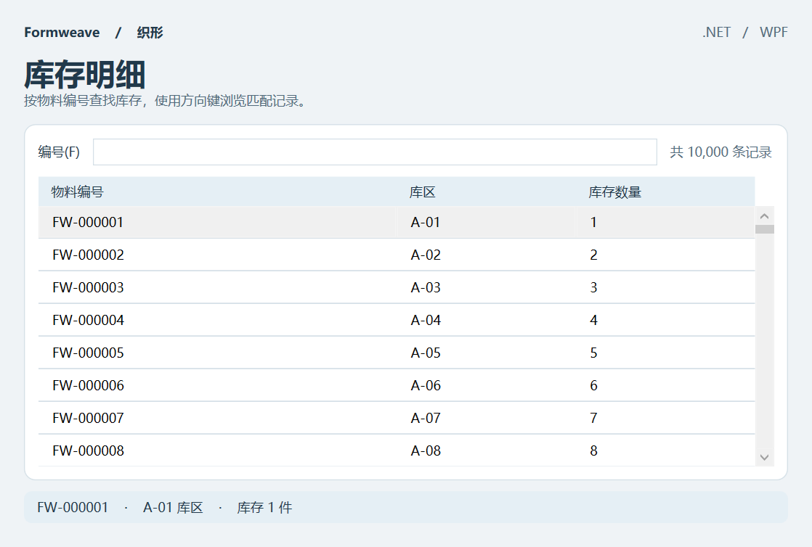
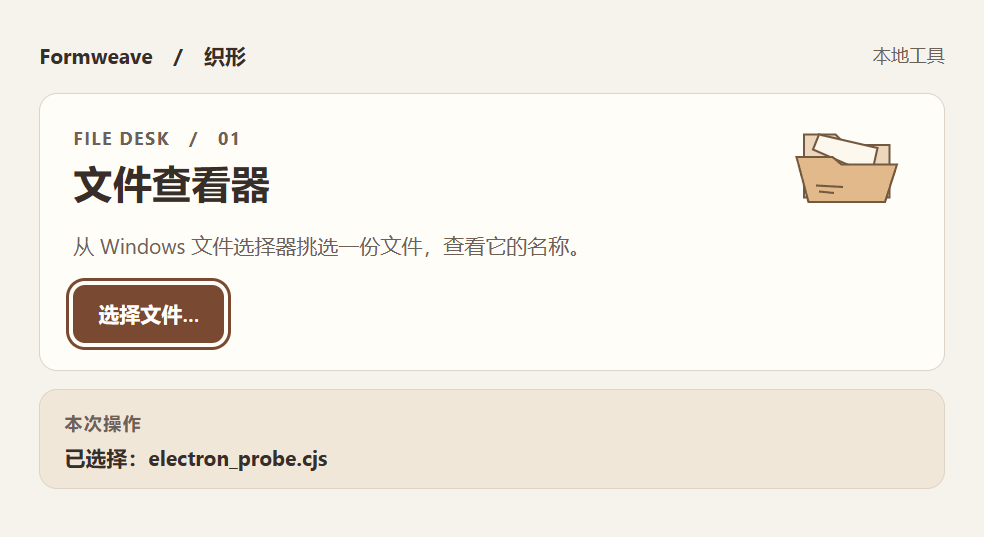

# Formweave · 织形


<p align="center">
  <a href="README.md">简体中文</a> · <a href="README.en.md">English</a>
</p>

Version **1.0.0** · Release date **2026-11-19** · [Changelog](CHANGELOG.md)

Formweave is an independently designed and implemented open-source collection of AI workflow skills for Windows 10/11 desktop applications. It covers requirements and planning, interface previews, development and delivery, and interface audits. The four skills can be installed and invoked individually or used together on the same project.

The workflows apply across desktop technology stacks, including Qt Widgets, Qt Quick/QML, WPF, WinForms, WinUI 3, Electron, Tauri/WebView2, Avalonia, and Flutter Desktop. Each skill adapts its implementation approach to the existing project, runtime environment, and delivery requirements. [Technology selection](skills/formweave-plan/references/frameworks.md)

## What the four skills do

### formweave-plan · Requirements and planning

Use this skill to establish the direction of a new application or assess the scope of a change to an existing one.

- Examine user scenarios, primary tasks, existing code, and runtime constraints to define the problem being addressed.
- Compare suitable technology choices and design business flows, state changes, data boundaries, background tasks, and code organization.
- Turn requirements into reproducible acceptance criteria, explaining tradeoffs, suggested defaults, and items that need verification.

The deliverable is an implementation plan for approval, with detail proportional to the task. [Skill entry](skills/formweave-plan/SKILL.md)

### formweave-preview · Interface and interaction previews

Use this skill to explore layout, visual style, interaction flows, or motion before committing to an implementation.

- Arrange navigation, tables, details, batch actions, and status feedback around the primary task, accounting for information density and narrow windows.
- Create a standalone visual, interactive HTML preview, or framework prototype that demonstrates the main operation and relevant exceptional states.
- Check light and dark themes, keyboard paths, focus, selection, interruptible motion, and reduced motion, identifying simulated behavior.

The deliverable includes a preview entry point, operating instructions, and the scope of verification. [Skill entry](skills/formweave-preview/SKILL.md)

### formweave-build · Development and delivery

Use this skill to create, change, optimize, or package an application within an approved scope, or to perform a read-only delivery readiness check.

- Work with the existing project and data behavior to implement the interface, business logic, background processing, and required Windows integration.
- Check performance, reliability, build entry points, dependencies, user data locations, and distribution choices, then verify affected operations.
- Prepare source, build artifacts, usage instructions, and change records as required, and complete project inventory and cleanup.

Deliverables include source, build artifacts, or a readiness report with runtime requirements, measured results, and unverified items. Remote writes and publishing follow separate authorization. [Skill entry](skills/formweave-build/SKILL.md)

### formweave-audit · Interface and usability audits

Use this skill to review screenshots, prototypes, source, or runnable builds, and to assess an interface after revision.

- Check information hierarchy, readability, action placement, data density, exceptional-state feedback, and keyboard access against the primary task.
- When a runnable environment is available, examine focus, scaling, window changes, interrupted motion, and final states after operations.
- Prioritize findings by impact, with locations, reproduction conditions, suggested fixes, and verification steps.

The deliverable is an evidence-based audit that distinguishes observations, inferences, and items requiring verification. [Skill entry](skills/formweave-audit/SKILL.md)

## Interface design showcase

The showcase presents visual style, layout structure, and interaction behavior. The two existing HTML previews use asset browsing and discrepancy review as their scenarios, making it easy to view designs, try operations, and compare states in a browser. Applications can implement these designs in their target technology stack.

| Design aspect | Preview | What to examine |
|---|---|---|
| Light and dark themes and surface layering | [Material Notes](skills/formweave-preview/assets/visual-motion-preview.html) | Dark translucent surfaces, light matte surfaces, rim light, shadows, and text contrast in the same composition. |
| Card layouts and object previews | [Material Notes](skills/formweave-preview/assets/visual-motion-preview.html) | Compact and grid layouts, hover and keyboard previews, confirmed selection, reversible transitions, and reduced motion. |
| Dense tables and a details pane | [Discrepancy review prototype](skills/formweave-preview/assets/inventory-preview.html) | The hierarchy of filters, data, and details, the current row and multiple selection, and narrow-window layouts. |
| Batch actions and status feedback | [Discrepancy review prototype](skills/formweave-preview/assets/inventory-preview.html) | Placement of selection summaries, actions, progress, cancellation, and completion feedback, together with focus changes. |

### Light and dark themes and card layouts

Switch between light and dark themes in the same layout to compare surfaces, rim light, and text hierarchy. Hover or press Tab to preview an object, then click or press Enter to confirm selection. Cards switch between compact and grid layouts, supporting reversal during a transition and reduced motion. The preview uses original geometric artwork and opens offline.

**Dark theme**



**Light theme**



### Dense tables and a details pane

The discrepancy review scenario demonstrates filters, a table, and a details pane. Examine information density, numeric comparisons, the current row, multiple selection, and batch action placement. The HTML prototype uses 72 synthetic records. Inspect records with the arrow keys, select with Space, start a simulated check with Ctrl+Enter, and cancel with Esc to explore keyboard paths and status feedback. Secondary details can be collapsed in a narrow window.



## Application samples

Three runnable Windows desktop applications provide starting points in their respective frameworks, demonstrating data handling, task execution, system calls, and result feedback. Their interfaces show how designs are implemented, with runtime and packaging choices determined by the framework.

| Application sample | Framework | Implementation focus |
|---|---|---|
| [Inventory review workbench](skills/formweave-build/assets/qt/workbench.py) | Qt Widgets / PySide6 | Model/view data, filtering and multiple selection, background checks, progress, and cancellation. |
| [Inventory details](skills/formweave-build/assets/wpf/MainWindow.xaml) | WPF / .NET | DataGrid binding, filtering 10,000 records, selection, and summary updates. |
| [File picker](skills/formweave-build/assets/electron/index.html) | Electron | Communication between the main process and page, the Windows file picker, operation states, and focus restoration. |

### Inventory review workbench · Qt Widgets

A model/view table supports identifier or name filtering, discrepancy categories, keyboard range selection, and linked details. Background checks operate on the selection captured at the start, with progress, completion counts, results, and cancellation.



### Inventory details · WPF

A DataGrid and data binding display 10,000 synthetic inventory records, with identifier filtering, arrow-key browsing, and a summary of the current row. This sample provides a starting point for detail queries and business forms.



### File picker · Electron

The interface centers on selecting a file. The main process opens the Windows file picker and returns the selected filename for display. The page handles pending, cancelled, failed, and successful operations, repeated activation, and focus after the dialog closes.



See the [sample instructions](skills/formweave-build/references/examples.md) for the complete files to copy, environment requirements, and commands for Qt Widgets, WPF, and Electron. The design preview and application screenshots come from the repository's existing validation records.

## Verification coverage

- **The repository and installation tools** have passed static validation and isolated tests for installation, updates, conflict protection, and failure recovery.
- **Design previews and application samples** have Windows 11 records for browser previews, Qt interactions, and WPF and Electron execution. Dates, tool versions, and check scopes are in the [validation record](docs/validation.md).
- **Unverified areas** include physical Windows 10 machines, mixed-DPI displays, actual Chinese IME behavior, samples in other stacks, production projects, and execution in Claude Code. Validate each application in its target framework and environment. [Compatibility](docs/compatibility.md)

## Install and update

### Get the source and prepare the environment

The installation and update tools require only the Python 3.13 standard library. Prepare the corresponding frameworks and toolchains when running desktop samples. Skill instructions and references are primarily in Simplified Chinese.

Get the repository source and open PowerShell at its root. With Git, use the following commands.

```powershell
git clone https://github.com/symphonyXY/Formweave.git
Set-Location Formweave
py -3.13 --version
```

### Install all skills or selected packages

Set `$dest` to a skill parent directory scanned by your client. Reuse the original destination for an existing installation.

```powershell
$dest = "$env:USERPROFILE/.agents/skills"
py -3.13 -B scripts\manage.py install --dest $dest
```

All four skills are installed by default. To select a single skill, use the command below. Repeat `--skill` to select multiple packages.

```powershell
py -3.13 -B scripts\manage.py install --dest $dest --skill formweave-preview
```

Claude Code users can try the corresponding `.claude/skills` directory. See [compatibility](docs/compatibility.md) for the client adaptation status.

### Invoke a skill

After installation, invoke the relevant skill in a new conversation. Provide the project path or materials, Windows version, primary task, behavior to preserve, and expected deliverables. Explicit approval already given can be reused.

**Plan the work**

> Use $formweave-plan to plan a Windows inventory tool. Define filtering, discrepancy review, batch checks, and cancellation, then propose a technology approach and acceptance criteria.

**Explore a design**

> Use $formweave-preview to create a standalone interactive preview with synthetic data. Demonstrate linked table and detail views, batch selection, a narrow-window layout, and reduced motion.

**Implement approved functionality**

> The current project is approved to use Qt Widgets. Use $formweave-build to implement the approved inventory review functionality, verify the build and runtime behavior, and deliver source and operating instructions.

**Review an existing interface**

> Use $formweave-audit to review the current project's interface and interactions. Focus on keyboard paths, filtering and selection, task cancellation, and result feedback, then prioritize suggested fixes.

### Update and verify

After obtaining updated source, run the update from the repository root against the original installation destination, then verify the files and receipts.

```powershell
$dest = "$env:USERPROFILE/.agents/skills"
py -3.13 -B scripts\manage.py update --dest $dest
py -3.13 -B scripts\manage.py verify --dest $dest
```

For partial installations, add the same `--skill` options to `update` and `verify`. The installer synchronizes file inventories and hashes, allowing a managed installation with a higher version number to be synchronized to the current source baseline.

The installer reports conflicts involving local edits, invalid receipts, or leftover locks. Follow the [installation recovery guide](CONTRIBUTING.md#安装冲突与恢复) to check the destination and recovery copies before continuing with the update and verification.

## Development and maintenance

- The [contributor guide](CONTRIBUTING.md) covers directory conventions, version management, validation commands, and task cleanup.
- [Skill design](docs/skill-design.md) explains skill entry points, package resources, and independent installation.
- [Behavior evaluations](evals/README.md) document workflow selection, execution scope, and behavioral checks.
- The [changelog](CHANGELOG.md) records released and pending changes.

This project is licensed under the [MIT license](LICENSE).
