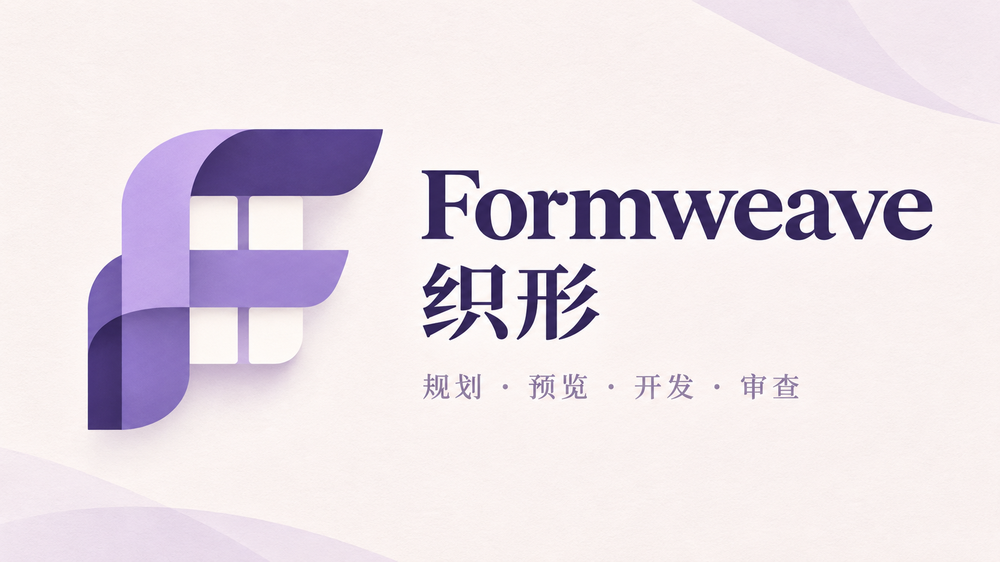
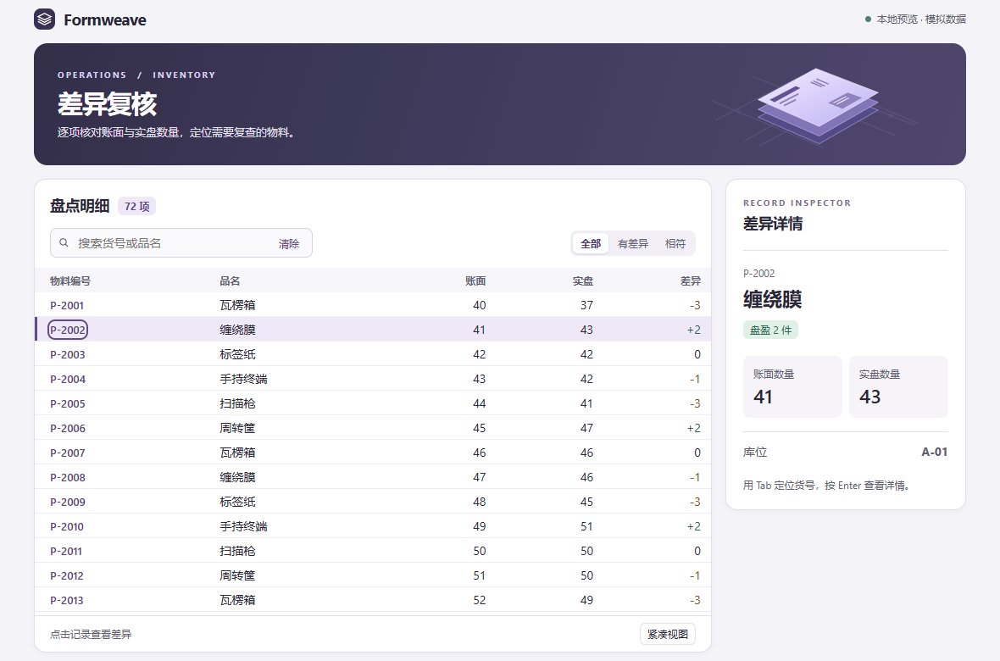
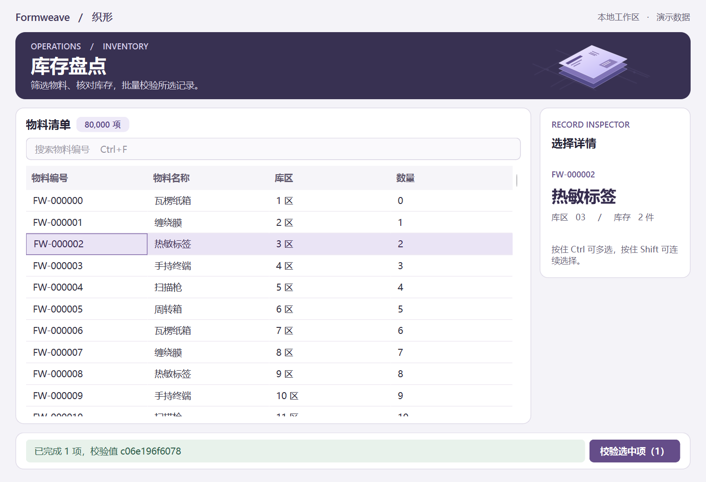
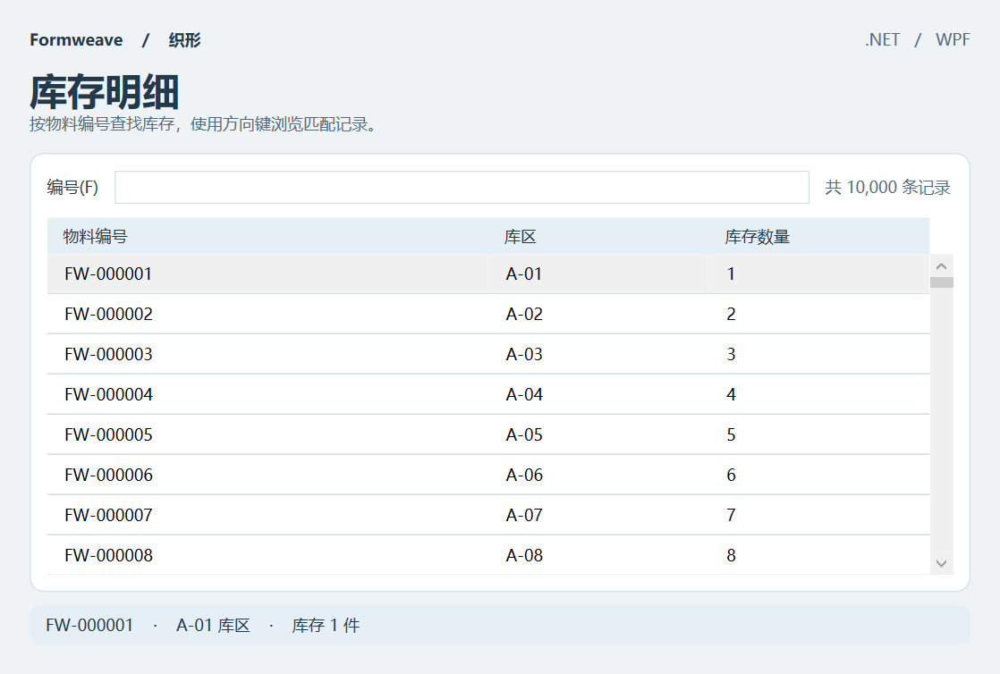
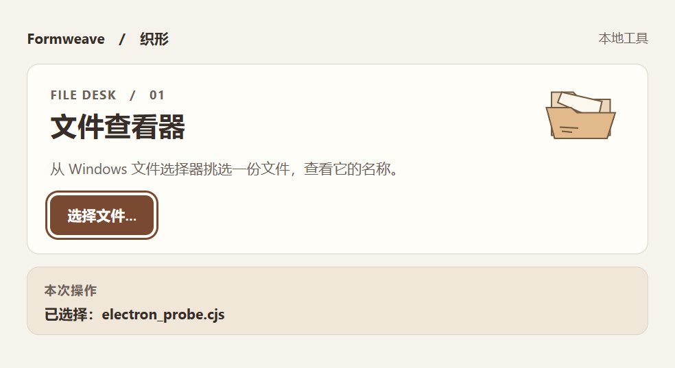

<div align="center">



# Formweave · 织形

[简体中文](README.md) · [English](README.en.md)

**Help AI plan, design, build, and audit Windows desktop applications through practical workflows.**

[](#skill-index)
[](docs/compatibility.md)
[](#quick-start)
[](LICENSE)

[Install](#installation) · [Quick start](#quick-start) · [Skill index](#skill-index) · [Screenshots](#screenshots) · [FAQ](#faq) · [Contribute](#contributing-and-development)

</div>

Version **1.0.0** · Release date **2026-11-11** · [Changelog](CHANGELOG.md)

Formweave is a collection of desktop development skills organized around `SKILL.md`, primarily for use with Codex. Give your agent requirements, screenshots, or an existing project to work through clarification, interface previews, application changes, packaging checks, and interface audits. Install each of the four skills independently or use them together.

The project README is available in Chinese and English. Skill instructions and reference documents are primarily in Simplified Chinese.

> **Current status:** The bundled Qt, WPF, and Electron samples have local execution and delivery evidence on Windows 11 x64. Windows 10 is a target platform and has not been verified on a physical machine. A specification-based trial setup is provided for Claude Code, but client testing is pending. [Compatibility and validation scope](docs/compatibility.md)

## Contents

- [What you can do](#what-you-can-do)
- [Screenshots](#screenshots)
- [Installation](#installation)
- [Quick start](#quick-start)
- [Skill index](#skill-index)
- [Updating](#updating)
- [FAQ](#faq)
- [Contributing and development](#contributing-and-development)
- [References and license](#references-and-license)

## What you can do

| Your situation | How Formweave helps |
|---|---|
| You have an idea but have not settled on an approach. | Identify users, primary tasks, platforms, data volumes, and delivery conditions; compare technical options and propose a scope and acceptance criteria for confirmation. |
| You want to explore the interface and interactions first. | Create a standalone visual or interactive preview of primary paths, exception states, and simulated interactions. |
| You need to change an existing application. | Investigate current behavior, implement changes within the confirmed scope, verify shortcuts, data handling, and native integration, then deliver source or builds. |
| The interface works, but its usability needs review. | Review screenshots, prototypes, source, or builds and report issues with locations, effects, priorities, and verification steps. |

The skills include Simplified Chinese collaboration guidance for dense tables, keyboard navigation, Chinese text input, scaling, task cancellation, and reduced motion. Framework references cover multiple technical options, with Qt Widgets, WPF, and Electron starter samples included. See the [compatibility matrix](docs/compatibility.md) for evidence levels.

Application development and changes begin by checking scope and acceptance criteria. Explicit confirmation already given in the conversation can be reused. You can also request only a plan, preview, or audit using the corresponding skill.

## Screenshots

### Interactive preview: inventory discrepancy review



Open the [single-page HTML preview](skills/formweave-preview/assets/inventory-preview.html). Try filtering for discrepancies, selecting a row to view its details, and switching to the compact view. If GitHub displays the HTML source, download the full repository and open the file locally in a browser. The preview uses 72 simulated records.

<details>
<summary>View the native Qt, WPF, and Electron samples</summary>

**Qt Widgets · Inventory workbench**



Includes model filtering, selection summaries, batch validation, and task cancellation.

**WPF · Inventory details**



Includes a filterable data table and a summary of the selected record.

**Electron · Local file viewer**



Demonstrates interaction between a web interface and the native Windows file picker.

See the [sample guide](skills/formweave-build/references/examples.md) for run and build instructions, and the [validation record](docs/validation.md) for the environments and measurements behind these screenshots. Evidence for bundled samples does not establish acceptance for every generated application.

</details>

## Installation

Get the repository source and install Python 3.13. Open PowerShell at the repository root and run:

```powershell
py -3.13 -B scripts\manage.py install --dest "$env:USERPROFILE/.agents/skills"
```

This installs all four skills for Codex. Open a new conversation and enter `Use $formweave-plan to prepare a plan for my Windows desktop project.` Installing the skills does not require Qt, .NET, or Electron.

<details>
<summary>Other options: Claude Code, project-level installation, or a single skill</summary>

**Claude Code:** use the `.claude/skills` directory instead. Client testing is pending.

```powershell
py -3.13 -B scripts\manage.py install --dest "$env:USERPROFILE/.claude/skills"
```

Invoke the skills with names such as `/formweave-plan`.

**Project-level installation:** set `--dest` to `.agents/skills` for Codex or `.claude/skills` for Claude Code inside the target project. Choose one installation scope to avoid duplicate discovery.

**Install a single skill:** add `--skill`, for example:

```powershell
py -3.13 -B scripts\manage.py install --dest "$env:USERPROFILE/.agents/skills" --skill formweave-preview
```

Each skill works independently without a separate shared support package. Repeat `--skill` to select multiple skills.

</details>

<details>
<summary>Optional: verify the installation</summary>

The installer checks copied content automatically. To run a separate verification:

```powershell
py -3.13 -B scripts\manage.py verify --dest "$env:USERPROFILE/.agents/skills"
```

Use your actual destination if it differs. For a partial installation, add the corresponding `--skill` options. A successful check reports `一致` (matching) for each selected skill. If the client list has not refreshed, open a new conversation or restart the client.

</details>

## Quick start

After installation, copy a request that matches your task and add project paths, screenshots, or data constraints. These English examples describe the same tasks as the Chinese README; the bundled skill instructions remain primarily in Simplified Chinese.

**Compare approaches first**

```text
Use $formweave-plan. We have a C# team and existing WPF controls. Our inventory
workbench must process 80,000 rows offline. Compare retaining WPF with other
viable options, and give me a plan and proposed acceptance criteria first.
```

**Preview an interactive interface**

```text
Use $formweave-preview. Create a Chinese inventory workbench preview with a
dense list on the left and discrepancy details on the right. Show an empty
filter result and cancellation of a batch task. Use simulated data.
```

**Investigate an existing project before making changes**

```text
Use $formweave-build. Inspect the existing project before adding batch actions
to the inventory list. Preserve file drag-and-drop and data formats, and list
the scope and acceptance conditions that need my confirmation.
```

**Audit without changing code**

```text
Use $formweave-audit. Only review the attached application screenshot. Report
each issue with its location, user impact, priority, proposed fix, and how to
verify it. Explain what cannot be established from the screenshot.
```

If you do not know which skill to use, describe the Windows desktop task and let the agent choose from the skills it has discovered. Provide the primary operation, existing project or materials, behavior that must be preserved, and expected deliverables whenever possible.

## Skill index

| Skill | When to use it | Main output |
|---|---|---|
| [formweave-plan · Plan](skills/formweave-plan/SKILL.md) | Requirements, technical choices, or development scope are unsettled. | Architecture, framework and code organization recommendations, with scope and acceptance conditions for confirmation. |
| [formweave-preview · Preview](skills/formweave-preview/SKILL.md) | You want to explore layout, styling, interactions, or motion first. | A standalone image, HTML preview, or framework prototype, with entry points and simulation boundaries. |
| [formweave-build · Build](skills/formweave-build/SKILL.md) | You need a new application, changes, optimization, packaging, or delivery troubleshooting. | Source or builds within the confirmed scope, runtime conditions, and verification records. |
| [formweave-audit · Audit](skills/formweave-audit/SKILL.md) | You want a review of an interface or its interactions. | Evidence-based issues ordered by impact, with priorities, proposed fixes, and verification steps. |

A common sequence is Plan → Preview → Build → Audit. If the scope is already clear, start with the relevant skill.

All four skills include a [desktop motion decision guide](skills/formweave-build/references/motion.md) and a [source index](skills/formweave-build/references/motion-index.md). The unreleased working tree adds [60 Motion Hub entries](skills/formweave-build/references/motion-hub-index.md) to the existing 57 LuckyMaomi and 160 Motion.Lab entries, for 277 source entries in total. Indexes load on demand; catalog coverage does not imply native implementation or acceptance testing.

Each entry point states its environment requirements in the body, followed by execution, conditional references, and delivery criteria. The motion source navigator points to three independently loaded catalogs; every installed package remains self-contained. Scope checks reuse available information and ask only about gaps that affect the current decision.

The [interface and motion adaptation guide](skills/formweave-build/references/interface-motion.md) connects search and filters, inspectors, local parameter controls, themes, and tab indicators to desktop tasks. Planning records states and acceptance criteria, previews compare normal and reduced motion, implementation binds real business data, and audits verify repeated input and focus. Existing frameworks and approved scope carry forward. For example: “Use Motion.Lab's inspector and Motion Hub's segmented tabs in a standalone preview for our existing WPF inventory tool, keeping the table stable.”

## Updating

After updating the local repository source, run this from the repository root:

```powershell
py -3.13 -B scripts\manage.py update --dest "$env:USERPROFILE/.agents/skills"
```

Use the original installation destination if it differs. For a partial installation, add the corresponding `--skill` options. To check the result, use the `verify` command in the installation section.

Installing or updating identical content reports `一致` (matching). Each skill is verified and replaced independently. If one skill fails, skills successfully processed earlier remain valid.

<details>
<summary>Handle installation conflicts and interruptions</summary>

The installer stops if a destination lacks a receipt, has an invalid receipt, has local changes, contains links, or already has a lock. Back up and compare the state; do not regenerate a receipt to overwrite differences.

After an interruption, first confirm that the process recorded in the lock has ended. Back up and compare `previous`, `new`, and the existing target inside the adjacent `.formweave-stage-*` directory. Restore a complete `previous` directory only when the target is absent. If automatic restoration fails, the installer retains the backup and reports its path. Inspect the state before handling the specific leftover lock; do not delete skill directories in bulk.

A restored older package may differ from the current source; a `verify` mismatch does not by itself mean restoration failed. To continue upgrading, run `update` with the original destination, then `verify`. To retain the older package, verify it against the matching older source.

</details>

## FAQ

### Can I run desktop applications immediately after installing the skills?

The skills provide workflows, references, and samples. Running an application still requires its framework, SDK, or runtime. Generated source, a successful build, and verified usability are separate acceptance checks. [Environments and commands for the three samples](skills/formweave-build/references/examples.md)

### Why does development begin with scope confirmation?

Application changes can affect data, native integration, and delivery, so acceptance conditions should be agreed first. Explicit approval in the current conversation can be reused. Confirm again only when the platform, framework, data behavior, or deliverables change. [Confirmation agreement](skills/formweave-build/references/agreement.md)

### Can I use this for websites or mobile applications?

This project focuses on Windows desktop applications. Mobile system designs may inform decisions, but they must be adapted to desktop tasks and input methods. HTML previews communicate desktop designs; their outcomes still require native verification.

### What is the support level for Windows 10, other architectures, and Claude Code?

Windows 11 x64 has local sample evidence. Actual execution on Windows 10, ARM64, x86, and Claude Code still needs verification. Check each framework's minimum system requirements against its selected dependency version; a target-platform badge alone does not establish compatibility. [Compatibility matrix](docs/compatibility.md) · [Validation and gaps](docs/validation.md)

### What if a skill is missing or installation fails?

Confirm that the destination is within the client's discovery scope, run `verify` again, then open a new conversation or restart the client. When reporting a problem, include the client version, Windows build, Python version, exact command, and full error. For local changes or installation locks, inspect the state using the [updating guidance](#updating).

## Contributing and development

Contributions can improve Chinese documentation, add framework and system validation, report reproducible problems, or expand behavioral evaluations using real tasks. Read the [maintenance rules](AGENTS.md) and [contribution guide](CONTRIBUTING.md) before starting. These documents are in Simplified Chinese.

```text
Formweave/
├── skills/       Four standalone skills, bundled references, previews and app samples
├── scripts/      Installation, update, validation and cleanup tools
├── tests/        Regression tests, interface probes and delivery checks
├── evals/        Natural-language requests and evaluation criteria
├── docs/         Compatibility, design rationale, visual assets and validation evidence
└── .github/      Windows continuous integration configuration
```

Set up the development environment and run checks:

```powershell
py -3.13 -m venv .venv
.\.venv\Scripts\python.exe -m pip install -r requirements-dev.txt
.\.venv\Scripts\python.exe -m pip check
.\.venv\Scripts\python.exe -B scripts\validate.py
.\.venv\Scripts\python.exe -B -m unittest discover -s tests -p "test_*.py" -v
.\.venv\Scripts\python.exe -B scripts\clean.py
```

By default, `clean` only previews candidate absolute paths and a manifest digest. Review them before adding `--apply` with the full digest from that preview. Cleanup is limited to bytecode generated by the current interpreter with a source file still present; other caches and unknown files are retained.

The repository's `.gitignore` excludes local `.env` files, keys, dependency directories, build outputs, and caches. Dependency lockfiles should still be committed. Use only `.env.example`, `.env.sample`, or `.env.template` for environment-variable templates, and never include real credentials. Ignore rules do not remove tracked files, so review the staging area before committing.

When adding or changing skills, keep each package self-contained, keep shared references with the same filename byte-for-byte identical, and update the Unreleased section of `CHANGELOG.md`. Record static checks, model behavior, sample execution, and real-project acceptance separately. [Skill design rationale](docs/skill-design.md) · [Behavioral evaluation method](evals/README.md)

## References and license

This README covers step-by-step installation, frequently asked questions, task examples, and a skill index. Its text and examples describe Formweave's actual capabilities.

Original skills, scripts, documents, and templates are provided under the [MIT license](LICENSE), and each standalone skill package includes a license file. Third-party runtimes, documents, icons, and fonts remain subject to their respective licenses. This repository does not distribute Qt, .NET, or Electron runtime binaries.
