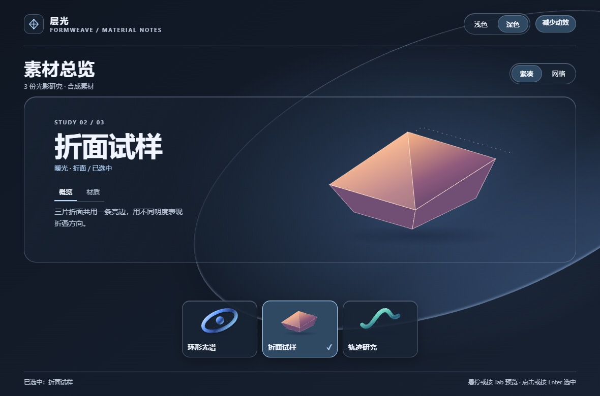
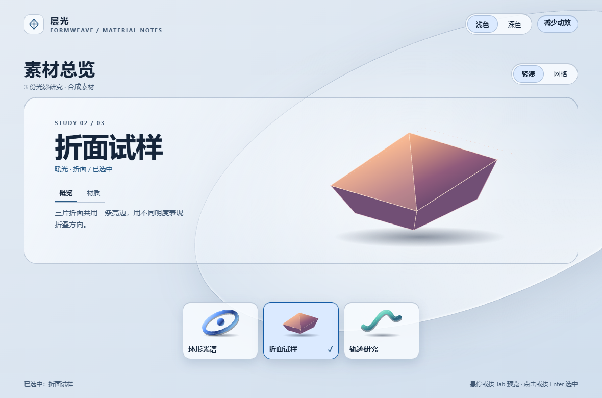
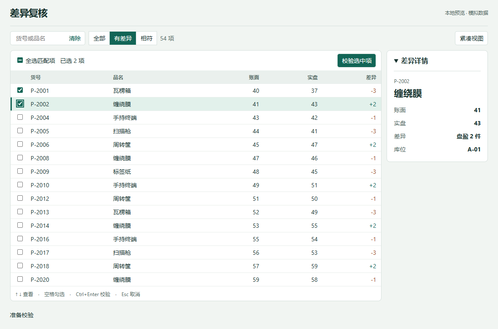
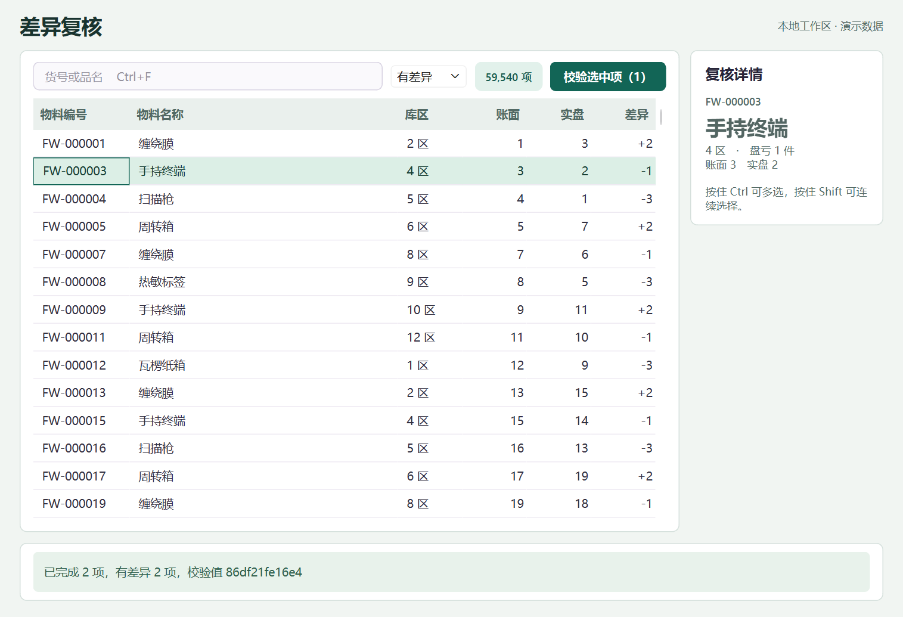
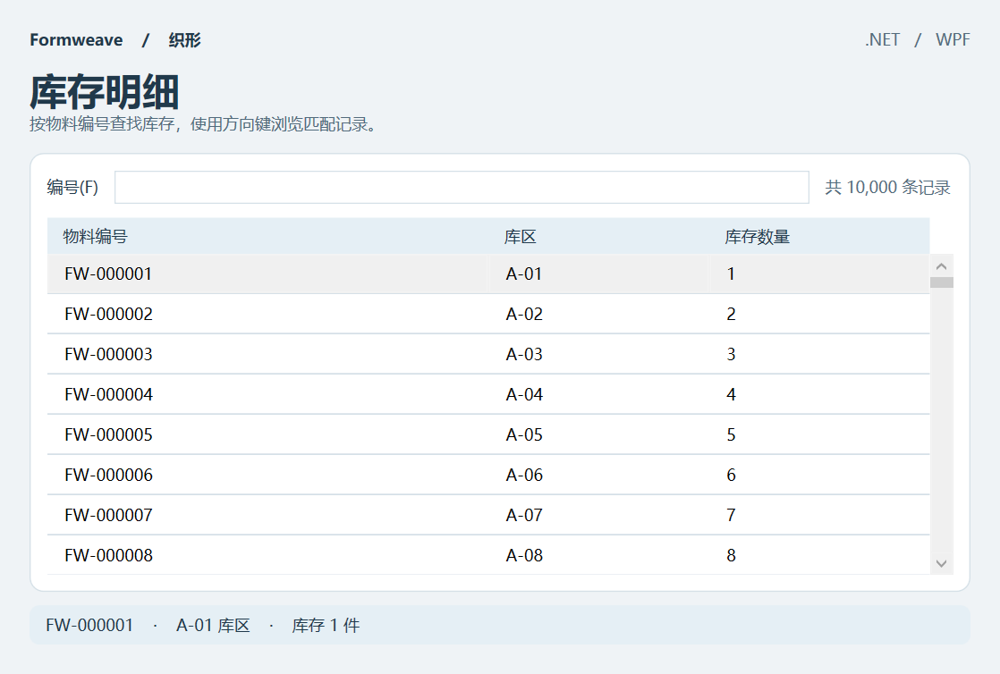
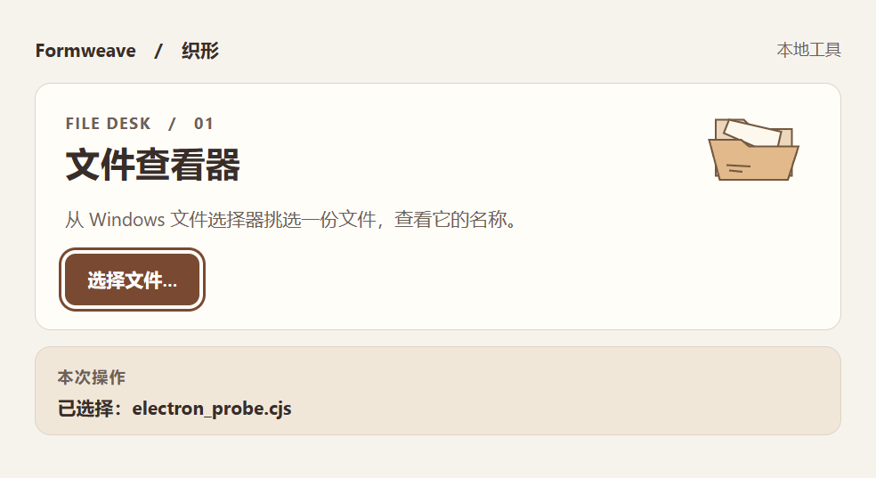

# Formweave · 织形


<p align="center">
  <a href="README.md">简体中文</a> · <a href="README.en.md">English</a>
</p>

版本 **1.0.0** · 定版日期 **2026-11-19** · [版本说明](CHANGELOG.md)

Formweave 是自主设计与实现的开源 AI 工作流技能集，面向 Windows 10/11 桌面应用，覆盖需求规划、界面预览、工程开发与交付、界面审查。四个技能可以独立安装、按需调用，也可以围绕同一个项目衔接使用。

工作流可用于不同的桌面技术栈，包括 Qt Widgets、Qt Quick/QML、WPF、WinForms、WinUI 3、Electron、Tauri/WebView2、Avalonia、Flutter Desktop 等。技能会结合已有工程、运行环境和交付要求选择具体实现方式。[技术栈选型](skills/formweave-plan/references/frameworks.md)

## 四个技能可以做什么

### formweave-plan · 需求与方案

适合新建应用前确定方向，或在改造已有应用前梳理影响范围。

- 分析使用场景、核心操作、现有代码与运行约束，明确本次需要解决的问题。
- 比较适用的技术路线，设计业务流程、状态变化、数据边界、后台任务和代码组织。
- 将需求转成可复验的验收条件，说明方案取舍、建议默认值和仍需验证的部分。

交付可确认的实施方案，深度随任务复杂度调整。[技能入口](skills/formweave-plan/SKILL.md)

### formweave-preview · 界面与交互预览

适合先查看布局、视觉风格、操作流程或动效，再确定正式实现。

- 按主任务安排导航、表格、详情、批量操作和状态反馈，兼顾宽窄窗口与信息密度。
- 制作独立图稿、HTML 可点击预览或框架原型，展示主操作及影响设计的例外状态。
- 检查深浅主题、键盘路径、焦点、选中、可中断动效和减少动效，并标明模拟内容。

交付可查看的预览入口、操作步骤和验证范围。[技能入口](skills/formweave-preview/SKILL.md)

### formweave-build · 开发与交付

适合在已确认范围内新建、修改、优化或打包应用，也可用于工程交付前的只读检查。

- 沿用已有工程和数据行为，实现界面、业务逻辑、后台处理及所需的 Windows 原生能力。
- 检查性能、可靠性、构建入口、依赖、用户数据位置和分发方式，复验受影响的操作。
- 按交付范围整理源码、构建产物、使用说明和变更记录，完成项目盘点与清理。

交付源码、构建产物或交付就绪报告，注明运行条件、实测结果及待验证项。远端写入与发布按单独授权执行。[技能入口](skills/formweave-build/SKILL.md)

### formweave-audit · 界面与可用性审查

适合检查现有截图、原型、源码或可运行构建，也适合复验改版效果。

- 从核心任务检查信息层次、可读性、操作入口、数据密度、异常反馈与键盘可达性。
- 有运行条件时，进一步检查焦点、缩放、窗口变化、动效中断及操作后的最终状态。
- 按影响和优先级记录问题，给出定位依据、复现条件、修复建议和复验方法。

交付有证据的审查报告，并区分观察结果、推断和待验证项。[技能入口](skills/formweave-audit/SKILL.md)

## 界面设计展示

界面设计从视觉风格、布局结构和交互行为三个方面展示。现有的两份 HTML 预览分别承载素材浏览与差异复核场景，便于在浏览器中查看设计、体验操作和比较状态。正式应用可按目标技术栈实现这些设计。

| 设计内容 | 预览入口 | 可以观察什么 |
|---|---|---|
| 深浅主题与材质层次 | [层光预览](skills/formweave-preview/assets/visual-motion-preview.html) | 同一构图下的深色半透明表面、浅色雾面表面、边缘光、阴影与文字对比。 |
| 卡片布局与对象预览 | [层光预览](skills/formweave-preview/assets/visual-motion-preview.html) | 紧凑与网格布局、悬停或键盘预览、确认选择、可反向过渡与减少动效。 |
| 密集表格与详情分栏 | [差异复核原型](skills/formweave-preview/assets/inventory-preview.html) | 筛选区、数据区与详情区的层级，当前行与多选状态，以及窄窗布局。 |
| 批量操作与状态反馈 | [差异复核原型](skills/formweave-preview/assets/inventory-preview.html) | 选择摘要、操作入口、进行中、取消与完成的反馈位置和焦点变化。 |

### 深浅主题与卡片布局

在相同布局下切换深浅主题，比较面板材质、边缘光与文字层次。悬停或按 Tab 临时预览，点击或按 Enter 确认选择。卡片可在紧凑与网格布局间切换，支持中途改向和减少动效。预览使用原创几何图，可离线打开。

**深色主题**



**浅色主题**



### 密集表格与详情分栏

以差异复核场景展示筛选区、表格和详情的分栏布局，重点观察信息密度、数值对照、当前行、多选和批量操作的位置。HTML 原型使用 72 条合成记录，方向键查看、空格勾选、Ctrl+Enter 模拟校验、Esc 取消，用于体验键盘路径和状态反馈。窄窗可收起次要详情。



## 程序示例

三个可运行的 Windows 桌面程序提供对应框架的工程起点，演示数据处理、任务执行、系统调用和结果反馈。程序中的界面可用于观察设计如何落地，运行与打包方式随框架确定。

| 程序示例 | 框架 | 演示的工程能力 |
|---|---|---|
| [库存复核工作台](skills/formweave-build/assets/qt/workbench.py) | Qt Widgets / PySide6 | 模型视图数据、筛选与多选、后台校验、进度与取消。 |
| [库存明细](skills/formweave-build/assets/wpf/MainWindow.xaml) | WPF / .NET | DataGrid 数据绑定、万行记录筛选、选择与摘要更新。 |
| [文件选择工具](skills/formweave-build/assets/electron/index.html) | Electron | 主进程与页面通信、Windows 文件选择器、调用状态与焦点恢复。 |

### 库存复核工作台 · Qt Widgets

以模型视图表格承载库存数据，支持货号或品名筛选、差异分类、键盘扩选和详情联动。后台任务按启动时的选中范围校验，显示进度、完成数量与结果，并支持取消。



### 库存明细 · WPF

通过 DataGrid 和数据绑定展示一万条合成库存记录，提供编号筛选、方向键浏览和当前行摘要。适合作为明细查询与业务表单的界面起点。



### 文件选择工具 · Electron

围绕选择文件这一主操作组织界面，由主进程调用 Windows 文件选择器，再显示选中的文件名。页面覆盖选择中、取消、失败和成功状态，处理重复触发与返回后的焦点。



Qt Widgets、WPF 和 Electron 的完整复制范围、环境与运行命令见[样例运行说明](skills/formweave-build/references/examples.md)。以上设计预览与程序截图来自仓库已有验证记录。

## 已验证范围

- **仓库与安装工具**已通过静态校验和隔离目标中的安装、更新、冲突保护及失败恢复测试。
- **设计预览与程序示例**已有 Windows 11 上的浏览器预览、Qt 交互，以及 WPF、Electron 的运行记录。具体日期、工具版本与检查范围见[验证记录](docs/validation.md)。
- **待验证项**包括 Windows 10 真机、混合 DPI 多屏、真实中文输入法、其他技术栈样例、真实生产项目及 Claude Code 实际运行。项目落地时按目标框架与环境验收。[兼容性说明](docs/compatibility.md)

## 安装和更新

### 准备源码与环境

安装与更新工具只依赖 Python 3.13 标准库。运行桌面样例时，再准备相应框架和工具链。技能正文与参考资料以简体中文为主。

取得仓库源码，在 PowerShell 中进入仓库根目录。使用 Git 时可以运行下面的命令。

```powershell
git clone https://github.com/symphonyXY/Formweave.git
Set-Location Formweave
py -3.13 --version
```

### 安装全部或指定技能

将 `$dest` 设置为客户端扫描的技能父目录。已有安装时沿用原目标目录。

```powershell
$dest = "$env:USERPROFILE/.agents/skills"
py -3.13 -B scripts\manage.py install --dest $dest
```

默认安装四个技能。只需一个技能时，可使用下面的命令，重复 `--skill` 可以选择多个技能。

```powershell
py -3.13 -B scripts\manage.py install --dest $dest --skill formweave-preview
```

Claude Code 可指定相应的 `.claude/skills` 目录试用，客户端适配状态见[兼容性说明](docs/compatibility.md)。

### 调用技能

安装后在新对话中按任务调用。提供工程路径或材料、Windows 版本、核心操作、必须保持的行为和预期交付物，有助于直接进入工作。已有明确确认可沿用。

**先确定方案**

> 使用 $formweave-plan 为 Windows 库存工具制定方案，梳理筛选、差异复核、批量校验与取消流程，给出技术路线和验收条件。

**先查看设计**

> 使用 $formweave-preview 制作独立的可点击预览。使用合成数据，展示表格与详情联动、批量选择、窄窗布局和减少动效。

**实现已确认的功能**

> 当前项目已确认采用 Qt Widgets。使用 $formweave-build 实现已确认的库存复核功能，完成构建与运行验证，并交付源码和运行说明。

**检查现有界面**

> 使用 $formweave-audit 审查当前项目的界面与交互，重点检查键盘路径、筛选与选择关系、任务取消及结果反馈，按优先级给出修复建议。

### 更新与核验

取得新版源码后，在仓库根目录对原安装目标执行更新，再核验文件与收据。

```powershell
$dest = "$env:USERPROFILE/.agents/skills"
py -3.13 -B scripts\manage.py update --dest $dest
py -3.13 -B scripts\manage.py verify --dest $dest
```

部分安装时，为 `update` 和 `verify` 添加相同的 `--skill` 选项。安装器按文件清单和哈希同步内容，允许已托管安装从较高版本号同步到当前源码基线。

遇到本地修改、无效收据或残留锁时，安装器会报告冲突。按[安装冲突与恢复](CONTRIBUTING.md#安装冲突与恢复)核对目标与恢复副本，再继续更新和核验。

## 开发与维护

- [贡献指南](CONTRIBUTING.md)说明目录约定、版本管理、验证命令与任务清理。
- [技能设计](docs/skill-design.md)说明技能入口、包内资料组织与独立安装方式。
- [行为评测](evals/README.md)记录工作流选择、执行范围与行为检查方法。
- [版本记录](CHANGELOG.md)记录已定版内容与待定版改动。

本项目采用 [MIT 许可证](LICENSE)。
