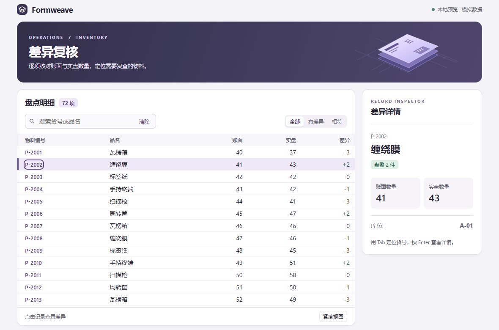
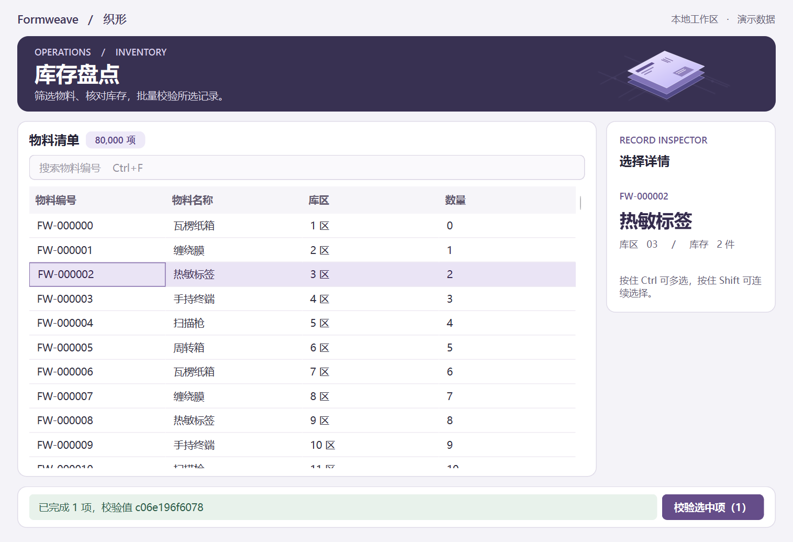
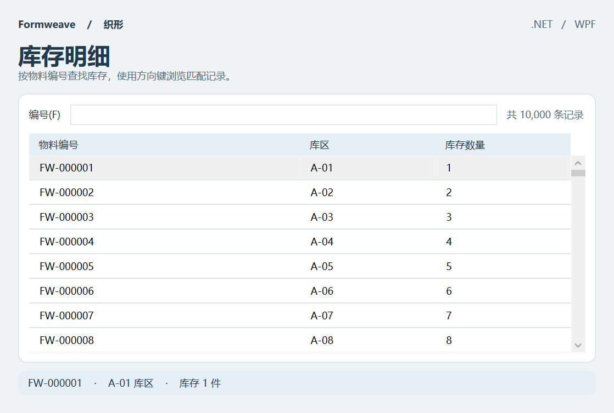
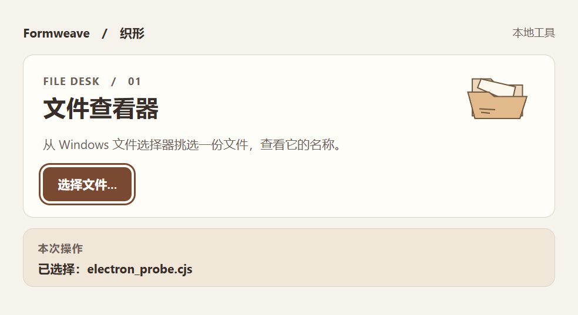

<div align="center">


# Formweave · 织形

[简体中文](README.md) · [English](README.en.md)

**让 AI 按真实工作流，规划、设计、开发和审查 Windows 桌面应用。**

[](#技能索引)
[](docs/compatibility.md)
[](#快速开始)
[](LICENSE)

[立即安装](#安装) · [快速开始](#快速开始) · [技能索引](#技能索引) · [界面展示](#界面展示) · [常见问题](#常见问题) · [参与贡献](#贡献与开发)

</div>

版本 **1.0.0** · 定版日期 **2026-11-11** · [版本说明](CHANGELOG.md)

Formweave 是一组以 `SKILL.md` 组织的桌面开发技能包，主要供 Codex 使用。把需求、截图或已有工程交给 Agent，即可从需求澄清、界面预览，推进到应用改造、打包验证与界面审查。四个技能可以按需单独安装，也可以组合使用。

项目说明提供中英文版本；技能正文与参考资料以简体中文为主。

> **当前状态：** Windows 11 x64 已有 Qt、WPF、Electron 样例的运行与交付证据；Windows 10 为目标平台，尚未实机验收。Claude Code 提供按规范配置的试用入口，尚未完成客户端实测。[兼容性与验证范围](docs/compatibility.md)

## 目录

- [你可以用它做什么](#你可以用它做什么)
- [界面展示](#界面展示)
- [安装](#安装)
- [快速开始](#快速开始)
- [技能索引](#技能索引)
- [更新](#更新)
- [常见问题](#常见问题)
- [贡献与开发](#贡献与开发)
- [参考与许可](#参考与许可)

## 你可以用它做什么

| 你现在的需求 | Formweave 提供的帮助 |
|---|---|
| 有想法，还没确定怎么做 | 梳理使用者、主任务、平台、数据规模和交付条件，比较技术路线，形成可确认的方案。 |
| 想先看看界面和操作流程 | 制作独立可查看或可点击的预览，展示主路径、例外状态和模拟交互。 |
| 有现成工程，需要增量改造 | 调查已有行为，在已确认范围内修改，复验快捷键、数据与原生集成，再交付源码或构建。 |
| 界面能用，但不知道哪里影响效率 | 根据截图、原型、源码或构建，列出有位置、有影响、有优先级和复验办法的问题。 |

技能内置简体中文协作指引，关注密集表格、键盘路径、中文输入、缩放、任务取消和减少动效等桌面场景。框架资料覆盖多种选型路线，随包提供 Qt Widgets、WPF 和 Electron 三个起点；具体证据等级见[兼容性矩阵](docs/compatibility.md)。

应用开发与改造先核对范围和验收标准；已有明确确认可以沿用。你也可以只要方案、预览或审查报告，分别使用对应入口。

## 界面展示

### 可点击预览：差异复核工作台



打开[单页 HTML 预览](skills/formweave-preview/assets/inventory-preview.html)，试着筛选“有差异”、切换行详情，再切到“紧凑视图”。GitHub 页面展示源码时，将完整仓库下载到本地后用浏览器打开该文件。预览使用 72 条模拟记录。

<details>
<summary>查看 Qt、WPF 与 Electron 原生样例</summary>

**Qt Widgets · 盘点工作台**



提供模型筛选、多选摘要、批量校验与任务取消。

**WPF · 库存明细**



提供可筛选的数据表与选中摘要。

**Electron · 本地文件查看器**



展示网页界面与 Windows 原生文件选择器的交互。

运行和构建方式见[样例说明](skills/formweave-build/references/examples.md)，截图对应的环境和测量见[验证记录](docs/validation.md)。这些是随包样例，不代表任意生成应用均已验收。

</details>

## 安装

准备好本仓库源码和 Python 3.13，在仓库根目录打开 PowerShell，运行：

```powershell
py -3.13 -B scripts\manage.py install --dest "$env:USERPROFILE/.agents/skills"
```

这会为 Codex 安装全部四个技能。随后打开新对话，输入 `使用 $formweave-plan，为我的 Windows 桌面项目整理方案。` 即可开始。安装技能不需要 Qt、.NET 或 Electron。

<details>
<summary>其他选项：Claude Code、项目级安装、只装一个技能</summary>

**Claude Code**：改用 `.claude/skills` 目录（尚未完成客户端实测）。

```powershell
py -3.13 -B scripts\manage.py install --dest "$env:USERPROFILE/.claude/skills"
```

调用使用 `/formweave-plan` 等名称。

**项目级安装**：将 `--dest` 后的路径改为目标项目内的 `.agents/skills`（Codex）或 `.claude/skills`（Claude Code）。建议选择一个作用域，避免重复发现。

**只安装一个技能**：追加 `--skill` 参数，例如：

```powershell
py -3.13 -B scripts\manage.py install --dest "$env:USERPROFILE/.agents/skills" --skill formweave-preview
```

四个技能均可独立使用，不需要另装共享支持包。`--skill` 可重复传入，选择多个技能。

</details>

<details>
<summary>可选：检查安装结果</summary>

安装器已校验复制内容；需要单独检查时再运行：

```powershell
py -3.13 -B scripts\manage.py verify --dest "$env:USERPROFILE/.agents/skills"
```

安装到其他位置时换成实际目标；只装部分技能时追加对应的 `--skill`。成功时各项报告“一致”。若客户端列表没有刷新，打开新对话或重启客户端。

</details>

## 快速开始

安装后，复制一条与你当前任务接近的请求，并补充工程路径、截图或数据约束。

**先比较方案**

```text
使用 $formweave-plan。我们有 C# 团队和一套 WPF 控件，盘点台要离线处理
8 万行数据。比较保留 WPF 与其他可行路径，先给我方案和验收建议。
```

**先看一个能点的界面**

```text
使用 $formweave-preview。先做一个中文盘点工作台预览，左侧密集列表，
右侧差异详情，展示筛选无结果和取消批量任务。使用模拟数据。
```

**调查现有工程，准备增量开发**

```text
使用 $formweave-build。请先检查当前工程，为库存列表增加批量操作，
保留已有文件拖放与数据格式，列出需要我确认的范围和验收条件。
```

**只审查，不改代码**

```text
使用 $formweave-audit。只审查我附上的窗口截图，按问题位置、用户影响、
优先级、建议改法和复验方式列出发现，并说明截图无法验证的部分。
```

不确定技能名时，也可以直接描述 Windows 桌面任务，让 Agent 根据已发现的技能选择入口。任务前尽量提供主操作、已有工程或材料、不可退化的行为及期望交付物。

## 技能索引

| 技能 | 使用时机 | 主要产出 |
|---|---|---|
| [formweave-plan · 规划](skills/formweave-plan/SKILL.md) | 需求、技术路线或开发范围尚未确定 | 架构、框架与代码组织建议，可确认的范围与验收条件。 |
| [formweave-preview · 预览](skills/formweave-preview/SKILL.md) | 想先看布局、样式、交互或动效 | 独立静态图、HTML 或框架原型，入口及模拟范围说明。 |
| [formweave-build · 开发](skills/formweave-build/SKILL.md) | 新建、改造、优化、打包或排查交付故障 | 按确认范围实现的源码或构建、运行条件与验证记录。 |
| [formweave-audit · 审查](skills/formweave-audit/SKILL.md) | 评审已有界面与交互 | 按证据和影响排序的问题清单、改法及复验方法。 |

常见推进顺序是“规划 → 预览 → 开发 → 审查”；已有明确范围时，可以直接从相应阶段开始。

四个技能均自带[桌面动效决策](skills/formweave-build/references/motion.md)与[来源索引](skills/formweave-build/references/motion-index.md)。当前工作区在原有 LuckyMaomi 57 项、Motion.Lab 160 项基础上补入 [Motion Hub 60 项](skills/formweave-build/references/motion-hub-index.md)，合计 277 个来源条目，尚未定版。索引按需读取，不代表全部效果已移植或通过原生验收。

每个入口先说明运行环境，再按“执行、按需参考、交付”组织。动效来源导航只列站点与查找方式，三站目录分别读取；安装后每个包仍可独立工作。范围确认从已有材料提取信息，只询问影响当前方案的缺口。

参考这两个网站做桌面设计时，按[界面与动效转化](skills/formweave-build/references/interface-motion.md)把搜索分类、检查器、局部调参、主题和标签指示器融入主任务。规划记录状态与验收，预览比较普通/减少动效，开发绑定真实业务，审查复验连续操作和焦点；保留现有框架与已批准范围。可以请求：“借鉴 Motion.Lab 的检查器和 Motion Hub 的分段标签，为现有 WPF 库存工具先做独立预览，表格保持稳定。”

## 更新

更新本地仓库源码后，在仓库根目录运行：

```powershell
py -3.13 -B scripts\manage.py update --dest "$env:USERPROFILE/.agents/skills"
```

安装到其他位置时，使用原来的目标路径；只装部分技能时，追加对应的 `--skill`。需要复核时使用安装节中的 `verify` 命令。

相同内容重复安装或更新会报告“一致”。每个技能独立校验并替换；某个技能失败时，此前已经完成的技能仍有效。

<details>
<summary>处理安装冲突与中断</summary>

目标没有收据、收据格式异常、存在本地修改、包含链接或锁已存在时，安装器会停止。先备份和比较现场，不要自行重建收据来覆盖差异。

操作系统中断后，先确认锁记录的进程已结束，备份并核对同目录 `.formweave-stage-*` 内的 `previous`、`new` 与现有目标。只有目标确实缺失且 `previous` 完整时，才将该副本恢复为原名；自动恢复失败也会保留副本并报告路径。核对现场后才处理对应残留锁，不要批量删除技能目录。

恢复出的旧包可能与当前源码不同，此时 `verify` 报差异不等于恢复失败。准备继续升级时，先用原目标路径执行 `update`，成功后再 `verify`；若要保留旧包，则使用与旧包相同的源码核验。

</details>

## 常见问题

### 安装技能后就能直接运行桌面程序吗？

技能提供工作流、参考资料和样例。运行具体应用仍需相应的框架、SDK 或运行库；源码生成、构建成功和实际可用是不同的验收项。[三个样例的环境与命令](skills/formweave-build/references/examples.md)

### 为什么开发前还会确认范围？

应用改造可能影响数据、原生集成和交付方式，需要先约定可验收的范围。当前聊天中已有明确批准时沿用；仅在改变平台、框架、数据行为或交付物等范围时重新确认。[确认约定](skills/formweave-build/references/agreement.md)

### 能用来做网站或手机应用吗？

本项目围绕 Windows 桌面应用。可以参考移动系统的设计，但需要转化为桌面任务与输入方式；HTML 预览用于表达桌面设计，其结果仍需原生验证。

### Windows 10、其他架构和 Claude Code 支持到什么程度？

Windows 11 x64 有本地样例证据；Windows 10、ARM64、x86 和 Claude Code 的实际运行仍待验证。具体框架的最低系统要求随依赖版本核对，不能仅凭目标平台徽章判断兼容性。[兼容性矩阵](docs/compatibility.md) · [验证与未覆盖项](docs/validation.md)

### 技能没有出现，或者安装报错怎么办？

先确认目标目录在客户端的扫描范围内，重新执行 `verify`，再打开新对话或重启客户端。提问时附客户端版本、Windows 构建、Python 版本、执行命令和完整报错；遇到本地修改或安装锁，先按[更新](#更新)核对现场。

## 贡献与开发

欢迎改进中文说明、补充框架与系统验证、提交可复现问题，以及完善真实任务的行为评测。开始前请阅读[维护约定](AGENTS.md)和[贡献指南](CONTRIBUTING.md)。

```text
Formweave/
├── skills/       四个独立技能、包内参考与预览/应用样例
├── scripts/      安装、更新、校验与清理工具
├── tests/        回归测试、界面探针与交付检查
├── evals/        自然语言请求和行为判据
├── docs/         兼容性、设计依据与验证证据
└── .github/      Windows 持续集成配置
```

维护环境与检查命令：

```powershell
py -3.13 -m venv .venv
.\.venv\Scripts\python.exe -m pip install -r requirements-dev.txt
.\.venv\Scripts\python.exe -m pip check
.\.venv\Scripts\python.exe -B scripts\validate.py
.\.venv\Scripts\python.exe -B -m unittest discover -s tests -p "test_*.py" -v
.\.venv\Scripts\python.exe -B scripts\clean.py
```

`clean` 默认仅预览候选绝对路径和清单摘要。审查后，才可追加 `--apply` 与本次完整摘要；处理范围仅限本解释器生成且仍有来源的字节码，其他缓存与未知文件保留。

仓库的 `.gitignore` 排除本地 `.env`、密钥、依赖目录、构建输出和缓存；依赖锁文件仍需提交。环境变量模板仅使用 `.env.example`、`.env.sample` 或 `.env.template`，且不得包含真实凭据。Git 忽略规则不会移除已跟踪文件，提交前仍需审查暂存区。

新增或修改技能时保持包内资源自包含、共享同名参考逐字一致，并同步 `CHANGELOG.md` 的 Unreleased。静态检查、模型行为、样例运行与真实项目验收分开记录。[技能设计依据](docs/skill-design.md) · [行为评测方法](evals/README.md)

## 参考与许可

README 包含分步安装、常见问题、任务示例与技能索引；文字和示例按 Formweave 的实际能力编写。

原创技能、脚本、文档与模板采用 [MIT 许可](LICENSE)，每个独立技能包均附许可文件。第三方运行库、文档、图标和字体遵循各自许可；本仓库不分发 Qt、.NET 或 Electron 的二进制运行时。
